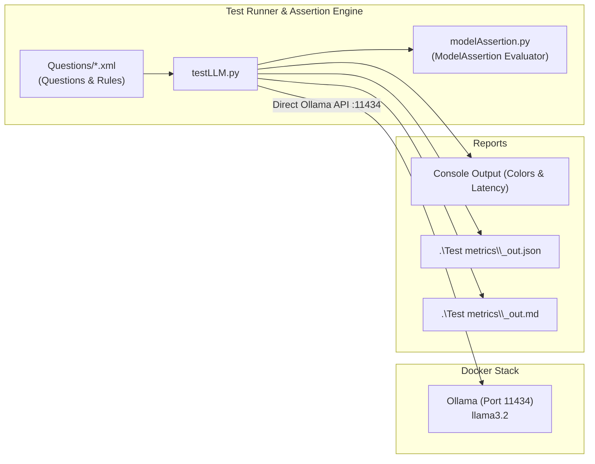

# Docker-Llama-LLM Test & Benchmark Framework

A testing and benchmarking framework to evaluate local LLM models (such as `llama3.2`, `smollm2`, `qwen2.5-coder`, `mistral-nemo`, etc.) running on Docker with Ollama and Open-WebUI.

---

## Architecture Overview



---

## 1. Quick Start

### Running the Tests

#### 1. Automated Multi-Model Benchmark (Full Suite)
To iterate through all curated models in `.env` (each started in its own isolated Docker container with automatic warm-up and clean shutdown between models):

```powershell
# Benchmark all curated models in .env:
.\run_all_models.ps1

# Benchmark specific models only:
.\run_all_models.ps1 -Models @("llama3.2", "smollm2:latest", "qwen2.5-coder:3b")

# Benchmark with verbose console output:
.\run_all_models.ps1 -VerboseOutput
```

#### 2. Single Model Test (Active Container)
To execute tests against the currently running container model:

```powershell
# Test model defined in .env:
.\run_tests.ps1

# Test a specific model:
.\run_tests.ps1 -Model "qwen2.5-coder:3b"

# Test with verbose output:
.\run_tests.ps1 -Verbose
```

---

## 2. Test Suites (`Questions/*.xml`)

All test suites are organized in `./Questions/*.xml`. `testLLM.py` automatically detects and runs all XML files in this directory:
- [Questions/questions_basic.xml](file:///c:/Workspace/Docker%20Workspace/Docker-Llama-LLM/Questions/questions_basic.xml): Core arithmetic, geography, code generation, and logic assertions.
- [Questions/questions_hard.xml](file:///c:/Workspace/Docker%20Workspace/Docker-Llama-LLM/Questions/questions_hard.xml): Adversarial and hard benchmark questions designed to test the limits of small (~3B) models (e.g. character counting, decimal comparisons like 9.11 vs 9.9, bat & ball math traps, lipograms, and word reversal).

```xml
<test_suite name="LLM Evaluation Suite">
    <test_case id="math-1" category="arithmetic">
        <name>Basic Addition (1+1)</name>
        <question>What is 1 + 1? Answer in one short sentence.</question>
        <system_prompt>You are a precise calculator assistant. Be concise.</system_prompt>
        <temperature>0.0</temperature>
        <max_tokens>50</max_tokens>
        <assertions>
            <!-- Check that answer contains '2' or 'two' -->
            <assert type="contains_any" case_sensitive="false">
                <expected>2</expected>
                <expected>two</expected>
            </assert>
            <assert type="not_contains" case_sensitive="false">error</assert>
            <assert type="max_latency_sec">15.0</assert>
        </assertions>
    </test_case>
</test_suite>
```

### Supported Assertion Types

| Assertion Type | Description | Example |
| :--- | :--- | :--- |
| `contains` | Checks if substring exists | `<assert type="contains">Paris</assert>` |
| `contains_any` | Passes if **at least one** of expected matches is present | `<assert type="contains_any"><expected>2</expected><expected>two</expected></assert>` |
| `contains_all` | Passes only if **all** expected matches are present | `<assert type="contains_all"><expected>def</expected><expected>return</expected></assert>` |
| `not_contains` | Passes if prohibited substring is **absent** | `<assert type="not_contains">London</assert>` |
| `regex` | Regular expression match | `<assert type="regex">def\s+is_even\s*\([^)]*\).*?:</assert>` |
| `exact` | Exact string match (ignoring leading/trailing whitespace) | `<assert type="exact">Blue</assert>` |
| `max_latency_sec` | Ensures response time is under threshold | `<assert type="max_latency_sec">10.0</assert>` |
| `min_tokens_per_sec` | Ensures generation throughput is above threshold | `<assert type="min_tokens_per_sec">25.0</assert>` |
| `not_empty` | Rejects empty output (requires text/sentence fabrication) | `<assert type="not_empty"/>` |
| `min_words` | Requires a minimum word count | `<assert type="min_words">4</assert>` |
| `min_length` | Requires a minimum character length | `<assert type="min_length">15</assert>` |

### SOLID Assertions Architecture (`modelAssertion.py`)

All evaluation logic is decoupled from runner orchestration and implemented in [modelAssertion.py](file:///c:/Workspace/Docker%20Workspace/Docker-Llama-LLM/modelAssertion.py) following SOLID design principles:

- **Single Responsibility Principle (SRP)**: Each assertion rule is encapsulated in its own class (`ContainsAssertion`, `ExactAssertion`, `RegexAssertion`, `MaxLatencyAssertion`, etc.) with a single reason to change.
- **Open/Closed Principle (OCP)**: New assertion rules can be added and registered via `AssertionFactory.register("new_type", NewAssertionClass)` without modifying existing classes or execution logic.
- **Liskov Substitution Principle (LSP)**: All assertions inherit from `BaseAssertion` and adhere to the uniform `evaluate(output: str, metrics: Dict[str, Any]) -> AssertionResult` contract.
- **Interface Segregation Principle (ISP)**: `BaseAssertion` defines only the essential interface needed for evaluation.
- **Dependency Inversion Principle (DIP)**: `TestCase` and `testLLM.py` depend on the `ModelAssertion` and `BaseAssertion` abstractions rather than hardcoded string-matching routines.
- **Unique Evaluator Class (`ModelAssertion`)**: Orchestrates assertion rule collection, batch evaluation against model outputs and metrics, and overall pass/fail determination.

---

## 3. Performance Metrics Measured

`testLLM.py` captures and calculates key performance indicators for each test case:

1. **Total Latency (`latency_sec` / `latency_ms`)**: Wall-clock response duration.
2. **Generation Speed (`eval_tokens_per_sec`)**: Completion tokens generated per second (e.g. `89.0 tok/s`).
3. **Prompt Evaluation Speed (`prompt_tokens_per_sec`)**: Tokens per second evaluated during prompt ingestion.
4. **Token Usage**:
   - `prompt_tokens`: Tokens in input prompt + context.
   - `completion_tokens`: Output tokens generated by the model.
   - `total_tokens`: Sum of prompt and completion tokens.
5. **Model Load Time (`load_duration_ms`)**: Time taken to swap/load model weights into GPU VRAM.

---

## 4. Multi-Model Benchmark & Comparison

Run multiple models simultaneously by supplying comma-separated names:

```bash
python testLLM.py --model llama3.2,smollm2:latest
```

Outputs a comparison table:
```
=====================================================================================
                        MODEL COMPARISON & BENCHMARK SUMMARY                         
=====================================================================================
Model                  | Pass Rate    | Assertions   | Avg Speed      | Total Time
-------------------------------------------------------------------------------------
llama3.2               | 100.0%       | 12/12        | 88.52 tok/s    | 3.73s     
smollm2:latest         | 91.7%        | 11/12        | 78.20 tok/s    | 5.12s     
=====================================================================================
```

Reports are automatically organized by model and timestamp:
- **Model-Specific Metrics**: `.\Test metrics\<model name>\<date time>_out.json` and `.md`
  - Example: [Test metrics/llama3.2/2026-10-19_16-12-49_out.md](file:///c:/Workspace/Docker%20Workspace/Docker-Llama-LLM/Test%20metrics/llama3.2/2026-10-19_16-12-49_out.md)
- **Comparison Reports** (when multiple models tested): `.\Test metrics\comparison\<date time>_comparison.json` and `.md`

---

## 5. Endpoints & Authentication

- **Ollama Direct (Default)**: Connects to `http://localhost:11434` (or `http://ollama:11434` inside Docker). No auth required. Provides native nanosecond-precision metrics.
- **Open-WebUI**: Connects to `http://localhost:3000/api/chat/completions`. Requires an active API key:
  ```bash
  python testLLM.py --endpoint openwebui --host http://localhost:3000 --api-key "sk-..."
  ```