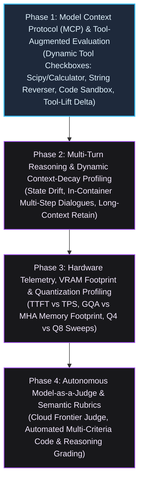
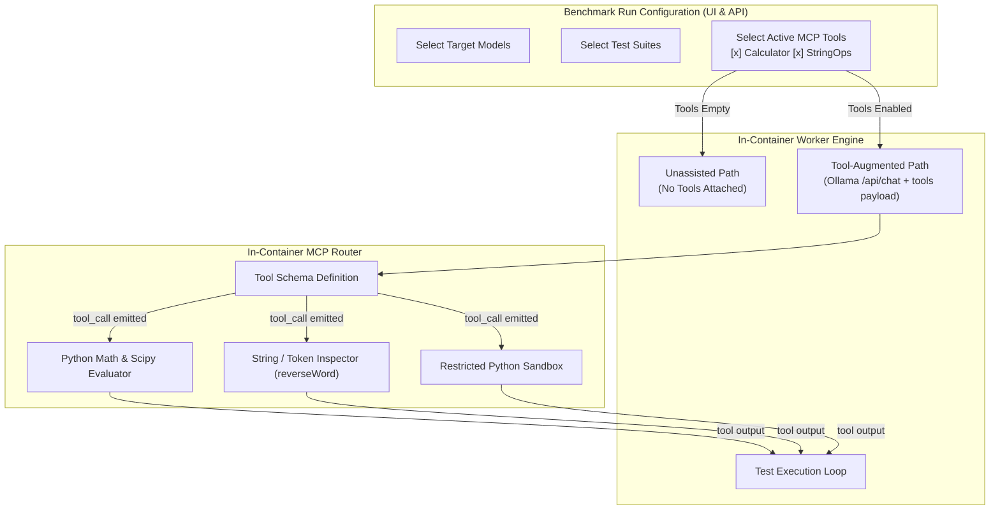

# Docker-Llama-LLM Platform Roadmap: Agentic & Advanced Empirical Evolution

## Executive Summary & Architecture Overview

The **Docker-Llama-LLM** platform provides an automated, containerized benchmarking and evaluation suite for local Large Language Models (`llama3.2`, `smollm2`, `qwen2.5-coder`, `phi3`, `gemma3`, `deepseek-r1`) and cloud frontier models (`gemini-2.0-flash`).

> [!NOTE]
> The foundational test harness, persistence layer, 4-tier taxonomy, comparative heatmaps, 113-probe question bank, web dashboard, and in-container asynchronous job queue (Phases 1–7) have been completed and are archived in [Documentation/roadmap1.md](file:///c:/Workspace/Docker%20Workspace/Docker-Llama-LLM/Documentation/roadmap1.md).

This roadmap outlines the next evolution of the platform: transitioning from static parametric text evaluation to **agentic tool-calling**, **multi-turn contextual dynamics**, **deep hardware VRAM profiling**, and **autonomous model-as-a-judge semantic evaluation**.



---

## Progress & Phase Status Tracker

| Phase | Designation | Focus Area | Status | Key Deliverable Artifacts |
| :--- | :--- | :--- | :--- | :--- |
| **Phase 1** | **MCP & Tool Evaluation** | Selective Tool Options (Calculator, Scipy, String/Tokenizer, Code Exec) | **In Progress** | In-container MCP Tool Router, Tool Checkbox UI, Schema Validator, Tool-Lift ($\Delta_{\text{Lift}}$) Metrics |
| **Phase 2** | **Multi-Turn Context Tracking** | Dynamic Dialogue Ingestion, State Retention & Drift Probing | **Planned** | Multi-Turn Question XML Schema, Dialogue Runner, Context-Length Decay Curves |
| **Phase 3** | **Hardware & VRAM Profiling** | TTFT vs TPS Latency Curves, VRAM MHA vs GQA Overhead | **Planned** | Hardware Telemetry Logger, VRAM Allocation Monitor, Quantization Comparison Matrix |
| **Phase 4** | **Model-as-a-Judge Evaluation** | Automated Semantic Rubric Grading for Open-Ended Tasks | **Planned** | Evaluator Client (`gemini-2.0-flash`), Rubric Prompt Engine, Correlation Analysis |

---

## Phase 1: Model Context Protocol (MCP) & Tool-Augmented Agentic Evaluation

### 1.1 Strategic Objective
Empower local models to selectively access external Python tools during benchmark runs **without compromising the pure, unassisted parametric benchmark**. 

By evaluating models both *with* and *without* tools, the platform measures **agentic capability**:
1. Does the model recognize its own cognitive limits (e.g., token-level character counting or large-number multiplication) and call a tool?
2. Does it adhere to strict JSON function schemas without syntax or hallucination errors?
3. Can it ingest the tool output and synthesize a clean, factual conclusion?

### 1.2 Dual-Mode Benchmark & Checkbox Tool Selection

The existing pure benchmark remains the default baseline. The Benchmark Runner UI and REST API (`POST /api/benchmark/run`) are enhanced with **modular MCP tool checkboxes**:

```
[ ] Pure Parametric Baseline (No Tools - Default)
[x] Python Scientific Calculator (math / scipy / numpy)
[x] Exact Text & Tokenizer Inspector (reverseWord, countChars, slice)
[ ] Code Execution Sandbox (Isolated Python execution)
[ ] Web / Document Retrieval Mock (Simulated search API)
```



### 1.3 Tool Suite Specification

1. **`python_calculator(expression: str)`**:
   - Evaluates closed-form arithmetic, exponentiation, trigonometric, and discrete mathematical functions using Python's standard `math` and `scipy`.
   - Directly probes questions like `math-basic` ($7 \times 8$), `math-long-multiplication` ($127 \times 849$), and `math-modulo-prime`.
2. **`text_inspector(action: str, text: str, character: Optional[str] = None)`**:
   - Solves tokenizer-blindness issues:
     - `action="reverse"`: Exact string reversal (solves `hard-reverse-word`).
     - `action="count"`: Character occurrence frequency (solves `hard-count-r` on "strawberry").
     - `action="length"`: Character-accurate string length.
3. **`code_executor(code: str)`**:
   - Executes small, isolated Python snippets within an execution sandbox to inspect runtime return values, solving logic trap probes like `illusion-misnamed-circle`.

### 1.4 Agentic Metrics & The Tool-Lift Delta ($\Delta_{\text{Lift}}$)

In addition to standard pass/fail metrics, Phase 1 introduces specialized agentic telemetry:
- **The Tool-Lift Delta ($\Delta_{\text{Lift}}$)**:
  $$\Delta_{\text{Lift}} = \text{Accuracy}_{\text{Tool-Augmented}} - \text{Accuracy}_{\text{Pure}}$$
- **Tool Trigger Precision**: Percentage of times the model correctly invoked a tool when the question demanded external calculation or string inspection.
- **Tool False-Positive Rate**: Invocations triggered on simple factual recall queries where tools are redundant (e.g., calling a calculator to determine the color of a leaf).
- **Schema Compliance Rate**: Percentage of `tool_calls` conforming to the exact expected JSON schema vs. malformed payloads or hallucinated parameters.
- **Tool Refusal Rate**: Cases where a model had access to a tool but stubbornly attempted to hallucinate calculations in raw prose (observed frequently in pure CoT models like DeepSeek-R1).

### 1.5 Verification & Phase Exit Gate
- [ ] In-container Python MCP Tool Router (`mcp_tools.py`) functional with zero external library bloat.
- [ ] Interactive checkboxes in the Web UI Benchmark Runner tab permitting selective tool attachment.
- [ ] Non-blocking dispatch accepts `tools` array and forwards tool schemas to Ollama `/api/chat`.
- [ ] Multi-turn tool execution loop executes requested tool and submits result back to model.
- [ ] Real-time SSE streaming logs display tool call invocations, arguments, and return payloads.
- [ ] Tool-Lift Delta $\Delta_{\text{Lift}}$ calculated and displayed in benchmark report summaries.

---

## Phase 2: Multi-Turn Reasoning & Dynamic Context-Decay Profiling

### 2.1 Strategic Objective
Expand the evaluation suite beyond single-turn prompt-response pairs into **stateful multi-turn dialogues**. Real-world agentic interactions require models to maintain state, follow conversational course corrections, and retain initial system instructions over thousands of generated tokens.

### 2.2 Capabilities & Architecture
1. **Multi-Turn Question Schema**: Extend the XML question definition with `<dialogue>` blocks containing sequential `<user>` and `<assistant>` turns:
   ```xml
   <test_case id="dialogue-inventory-tracking" tier="2" category="state_tracking">
       <name>Stateful Inventory Tracking</name>
       <turn index="1">
           <user>You start with 3 apples and 2 oranges.</user>
           <expected>acknowledged</expected>
       </turn>
       <turn index="2">
           <user>I give you 4 bananas and eat 1 apple.</user>
           <expected>acknowledged</expected>
       </turn>
       <turn index="3">
           <user>How many total pieces of fruit do you have now?</user>
           <assertions>
               <assert type="contains">8</assert>
           </assertions>
       </turn>
   </test_case>
   ```
2. **Instruction Retention & State Drift**: Measure whether constraints delivered in Turn 1 (e.g. *"Never use the letter 'e'"* or *"Act as a strict SQL compiler"*) are maintained through Turn 5 and Turn 10.
3. **Context Length Degradation Curves**: Evaluate model accuracy and generation speed as context expands from 512 tokens to 2,048, 4,096, and 8,192 tokens.

### 2.3 Verification & Phase Exit Gate
- [ ] Schema parser supports multi-turn dialogue structures in XML suites.
- [ ] In-container worker maintains conversational history across turns per test probe.
- [ ] Assertion engine evaluates intermediate and terminal turn assertions separately.
- [ ] Context degradation reports graph accuracy and token speed against conversational token depth.

---

## Phase 3: Hardware Telemetry, VRAM Footprint & Quantization Profiling

### 3.1 Strategic Objective
Provide deep empirical profiling of how model architectures (Multi-Head Attention vs Grouped-Query Attention) and quantization levels interact with physical GPU VRAM and compute constraints.

### 3.2 Capabilities & Architecture
1. **Time-To-First-Token (TTFT) vs Generation Speed**: Dissect latency into prompt processing duration (pre-fill phase) versus autoregressive token generation speed (`tok/s`).
2. **Dynamic VRAM Curve Profiling**: Monitor GPU VRAM allocation over time via internal container probes. Compare Multi-Head Attention (MHA, e.g. `phi3:mini` spilling into CPU RAM) against Grouped-Query Attention (GQA, e.g. `qwen2.5-coder:3b` operating 100% in VRAM).
3. **Quantization Impact Matrix**: Benchmark identical model weights across `Q4_K_M`, `Q5_K_M`, `Q8_0`, and `FP16` to calculate the exact accuracy-per-gigabyte tradeoff.

### 3.3 Verification & Phase Exit Gate
- [ ] TTFT pre-fill latency captured and persisted separately from autoregressive decoding speed.
- [ ] VRAM telemetry gathered during model pre-warm and peak inference generations.
- [ ] Memory footprint warnings generated when models exceed GPU memory limits and trigger CPU fallback.
- [ ] Comparative quantization Pareto chart rendered in the dashboard analytics tab.

---

## Phase 4: Autonomous Model-as-a-Judge & Semantic Verification

### 4.1 Strategic Objective
Introduce automated semantic grading for open-ended code explanations, architectural reasoning, and creative writing probes where deterministic string-matching assertions cannot capture nuances.

### 4.2 Capabilities & Architecture
1. **Frontier Evaluator Integration**: Route completed candidate outputs to a frontier judge (`gemini-2.0-flash` or local 7B+ teacher models) with a rigorous rubric prompt:
   ```json
   {
     "accuracy_score": 5,
     "completeness_score": 4,
     "conciseness_score": 5,
     "hallucination_flag": false,
     "reasoning": "The model correctly identified the race condition and provided a mutex fix."
   }
   ```
2. **Hybrid Assertion Grading**: Combine deterministic rule assertions (contains, regex, latency) with semantic judge scores to produce a weighted composite benchmark score.
3. **Self-Correction & Critique Probing**: Test whether smaller models can critique and improve their own answers when presented with automated feedback.

### 4.3 Verification & Phase Exit Gate
- [ ] Cloud judge connector (`gemini-2.0-flash`) integrated into evaluation pipeline for open-ended questions.
- [ ] Structured JSON grading schema validated with strict scoring rubrics (1–5 scale).
- [ ] Correlation reporting comparing semantic judge scores with deterministic assertions.
- [ ] Dashboard displays judge rationales and rubric breakdowns in the test inspector view.

---

## Master Implementation Schedule & Milestones

```mermaid
gantt
    title Docker-Llama-LLM Phased Enhancement Timeline
    dateFormat  YYYY-MM-DD

    section Phased Implementation Track
    Phase 1: Model Context Protocol (MCP) & Tools       :active, p1, 2026-10-28, 5d
    Phase 2: Multi-Turn Reasoning & State Retention     :p2, after p1, 4d
    Phase 3: Hardware & VRAM Telemetry Profiling        :p3, after p2, 4d
    Phase 4: Autonomous Model-as-a-Judge Grading        :p4, after p3, 5d
```

### Summary of Major Deliverables

| Target Milestone | Phase | Deliverable Files | Operational Capability |
| :--- | :--- | :--- | :--- |
| **Milestone 1** | Phase 1 | In-Container MCP Router, Tool Checkbox UI | Selective tool-calling (scipy, string reversal, code execution), Tool-Lift ($\Delta_{\text{Lift}}$). |
| **Milestone 2** | Phase 2 | Multi-Turn Dialogue Runner, State Probes | Sequential state tracking, context-length decay curves. |
| **Milestone 3** | Phase 3 | Hardware Telemetry Logger, VRAM Profiler | TTFT vs TPS latency curves, MHA vs GQA VRAM allocation. |
| **Milestone 4** | Phase 4 | Evaluator Client, Semantic Rubric Engine | Automated Model-as-a-Judge grading for open-ended answers. |
